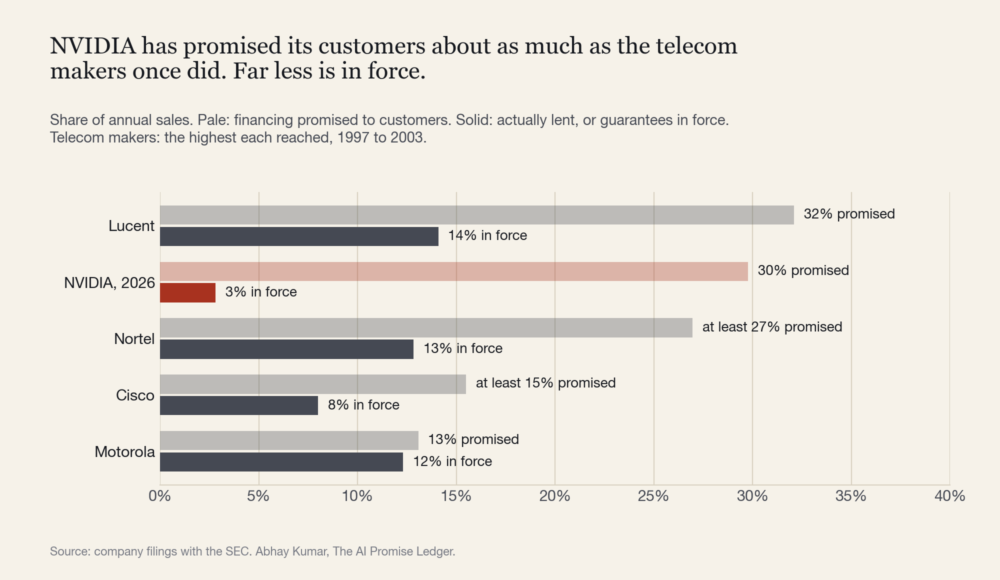

# The AI Promise Ledger

**AI spending now takes all the cash its biggest builders generate. This project follows the money that pays for the rest, using only what the companies have filed with the SEC.**

By Abhay Kumar. Figures are from filings read up to 17 November 2026.

## The argument in four findings

1. **The gap.** Microsoft, Alphabet, Amazon, Meta, Oracle and CoreWeave now put 98 cents of every dollar of cash their operations generate into buildings and equipment. Three of them spend more than they generate. In twelve months the six raised $374bn of new debt and sold $93bn of new shares.
2. **The promises.** On top of that they have signed $1.35 trillion of leases, mostly for data centers, that are not on their balance sheets yet, worth about $862bn in today's money. That is more than everything the six have borrowed.
3. **Who can carry it.** Counted as debt against today's earnings, those leases would take Oracle from 5.2 to 10.5 times its yearly cash earnings and CoreWeave from 12.9 to 17.8. The other four would stay under 3.3.
4. **The supplier.** Where a builder's own credit is not enough, NVIDIA has started to stand behind it: $138bn of guarantees and investments promised, 30% of its annual rate of sales, most of it one guarantee on a campus leased to OpenAI that has not started. Only 2.8% is in force. At their highest, between 1997 and 2003, Lucent, Nortel, Cisco and Motorola had promised their customers 13% to 32% of sales and had 8% to 14% actually lent or in force.

**My read:** the load is heaviest at Oracle and CoreWeave. On the supplier's side, the number to watch is how long NVIDIA waits to be paid (64 days, against 53 a year earlier), not the headline guarantee.




## The site

**[abhay-kumar-2501.github.io/ai-promise-ledger](https://abhay-kumar-2501.github.io/ai-promise-ledger/)**. The pages are the [`docs/`](docs) folder.

| Page | What it is |
|---|---|
| `index.html` | The argument on one page. It opens with a tool that shows how much of a fund sits in the companies selling AI equipment and the companies paying for it. Charts stay folded until asked for. |
| `spenders.html` | Evidence for findings 1 to 3: cash, leases, debt ratios, landlords. |
| `nvidia.html` | Evidence for finding 4: what NVIDIA has promised and to whom, collection times, and the telecom comparison. |
| `method.html` | Who did what, how each number can be checked, the judgment calls, and what changed after review. |

## What is in this repository

| Folder | Contents |
|---|---|
| `inputs/` | Figures collected from filings that no database provides, each with its sentence and link, including the telecom dataset and the landlord table. |
| `src/` | The code. Reading filings: `edgar`, `xbrl`, `text`, `fundamentals`. The spenders: `leases`, `lease_pv`, `commitments`, `funding_gap`, `leverage`. The supplier: `nvidia_financing`, `nvidia_supply`, `vendor_finance_history`. The fund tool: `fund_holdings`. The pages: `make_*` and `templates/`. |
| `data/processed/` | Every table the code produces, as CSV. |
| `checks/` | The 24 headline figures, the sentence each came from, and the result of re-checking them against fresh downloads. |
| `notes/` | Definitions and limits for each dataset. |
| `tests/` | Automated tests. They run offline. |
| `charts/` | Four still images for sharing. |

## Run it

```bash
python -m venv .venv && .venv/bin/pip install -r requirements.txt
cp .env.example .env    # the SEC asks automated readers to identify themselves
.venv/bin/python run.py
.venv/bin/python -m pytest
```

## Limits

- Lease and purchase commitments run for up to 30 years. A large total is not one year's bill.
- The debt ratios hold earnings at today's level and ignore signed customer contracts. They show the load if the new data centers earned nothing.
- The telecom comparison sets each company's highest reading against NVIDIA's latest.
- NVIDIA's latest quarter is from its results release, and fund holdings are reported a few months late.

Built with Claude Code. I am a finance student; this is a research project, not investment advice, and nothing here is a claim that any company has acted improperly.
