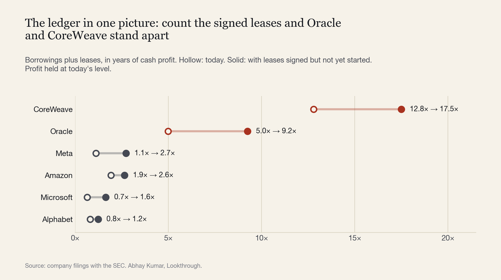

# Lookthrough

**How much of your retirement fund is riding on AI's data centers? Pick a fund and see, then look through to what the six companies building them have promised to pay.**

By Abhay Kumar. Figures are from filings read up to 17 November 2026.

## What it does

1. **Your fund.** Lookthrough reads what index funds report holding. An S&P 500 fund has 16 cents of every dollar in the six companies building AI's data centers and 15 in the companies that sell them the equipment. A 2060 target-date fund has 17 cents in both together, a 2030 one 11.
2. **Their bills.** Microsoft, Alphabet, Amazon, Meta, Oracle and CoreWeave have borrowed $608bn. Count their leases and they have promised $1.7 trillion, nearly two thirds of it rent. Each company gets a bill, measured in years of its own cash profit.

OpenAI and Anthropic are not on this list. They are private companies and do not publish financial statements, and they rent much of their computing from companies that do.

## The ledger

One bill per company. The last column is the total measured in years of the company's own cash profit.

| Company | Borrowed | Leases running | Leases signed, not started | Total promised | In years of cash profit (before signed leases) |
|---|---|---|---|---|---|
| CoreWeave | $47bn | $19bn | $24bn | $91bn | 17.5 (12.8) |
| Oracle | $125bn | $44bn | $145bn | $314bn | 9.2 (5.0) |
| Meta | $84bn | $32bn | $169bn | $285bn | 2.7 (1.1) |
| Amazon | $190bn | $115bn | $117bn | $422bn | 2.6 (1.9) |
| Microsoft | $35bn | $98bn | $204bn | $338bn | 1.6 (0.7) |
| Alphabet | $126bn | $24bn | $79bn | $229bn | 1.2 (0.8) |
| **Six together** | $608bn | $333bn | $737bn | $1,678bn | 2.4 (1.4) |

The fourth column is the one this project exists for. A lease reaches the balance sheet only on the day the landlord hands over the building; until then it is one sentence in a footnote. The project collects that sentence from every report since 2021. The payments add up to $1.35 trillion; the ledger counts them at $737bn, what they are worth today at what each company now pays to borrow for ten years. At the older rates on their existing leases it would be $856bn.

**What it shows:** four of the six have promised under 2.8 years of their cash profit. Counting the signed leases takes Oracle from 5.0 to 9.2 and CoreWeave from 12.8 to 17.5. It is a stress reading, not a forecast.



## Why the bill keeps growing

The six put 98 cents of every dollar of cash their operations generate into buildings and equipment. In twelve months they raised $374bn of new long-term debt and sold $92bn of new shares.

**My read:** the bill is heaviest at Oracle and CoreWeave, and they are a small part of an ordinary fund (0.4 cents of each dollar in an S&P 500 fund). Most of what such a fund has riding on AI's data centers is in companies whose bills are short against what they earn, and in suppliers whose sales depend on the building continuing.

A companion note, [`nvidia.html`](docs/nvidia.html), looks at a related question: what NVIDIA has promised on behalf of some builders, beside what telecom equipment makers did around 2000.

## The site

**[abhay-kumar-2501.github.io/lookthrough](https://abhay-kumar-2501.github.io/lookthrough/)**. The pages are the [`docs/`](docs) folder.

| Page | What it is |
|---|---|
| `index.html` | The product: the fund tool, then the ledger. Each company's bill opens to show its lines and the filing behind them. Charts stay folded until asked for. |
| `spenders.html` | The workings behind each bill: cash, leases, what they are worth today, the ratios, the landlords. |
| `nvidia.html` | Companion note: what NVIDIA has promised and to whom, collection times, and the telecom comparison. |
| `method.html` | Who did what, how each number can be checked, the judgment calls, and what changed after review. |

## What is in this repository

| Folder | Contents |
|---|---|
| `inputs/` | Figures collected from filings that no database provides, each with its sentence and link. |
| `src/` | The code. Reading filings: `edgar`, `xbrl`, `text`, `fundamentals`. The builders: `leases`, `lease_pv`, `commitments`, `funding_gap`, `leverage`. The supplier: `nvidia_financing`, `nvidia_supply`, `vendor_finance_history`. The fund tool: `fund_holdings`. The pages: `make_*` and `templates/`. |
| `data/processed/` | Every table the code produces, as CSV. |
| `checks/` | 24 source figures with the sentence each came from, the result of re-checking them against fresh downloads, and the November 2026 audit. |
| `notes/` | Definitions and limits for each dataset. |
| `tests/` | Automated tests. They run offline. |
| `charts/` | Four still images for sharing. |

## Run it

```bash
python -m venv .venv && .venv/bin/pip install -r requirements.txt
cp .env.example .env    # the SEC asks automated readers to identify themselves
.venv/bin/python run.py
.venv/bin/python -m pytest
```

## Limits

- The leases run for up to 30 years. A large total is not one year's bill.
- What the signed leases are worth today depends on the interest rate. The ledger uses what each company now pays to borrow for ten years; that is a judgment, and the site shows the range.
- The last column holds profit at today's level and ignores signed customer contracts. Cash profit is EBITDA (operating income plus depreciation and amortization), which is after operating-lease rent; adding that rent back, as a rating agency would, lowers every ratio. Cash is not subtracted.
- Figures are at each company's latest quarter-end. Borrowing since then is listed on each bill, not added in.
- Fund holdings are reported a few months late.

Built with Claude Code. I am a finance student; this is a research project, not investment advice, and nothing here is a claim that any company has acted improperly.
